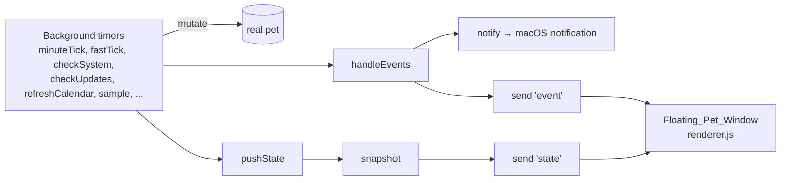
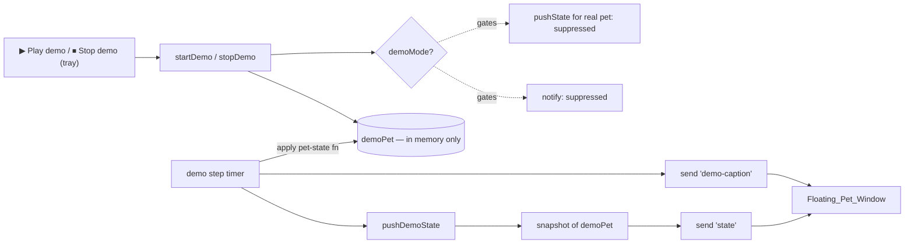

# Design Document

## Overview

Demo Mode is a self-contained, roughly 60-second presentation that plays Bytepet's
entire lifecycle on a throwaway pet. It is started from the macOS tray with a
"▶ Play demo" entry and walks a `Demo_Pet` through eight scripted steps — hatch,
feed, distraction, refocus, mess + flies, sickness, death into a ghost, and
revival — each announced by a short on-screen caption.

The dominant design concern is **isolation**. The demo must never touch the
user's real pet, tasks, profile, or achievements, must never be written to disk,
and must restore the real pet's display when it ends. A secondary concern is
**non-interference**: the main process runs many background timers that push real
pet state to the renderer and fire macOS notifications, and these must be silenced
while the demo plays so they can't overwrite the demo pet or interrupt it with a
notification.

The design achieves both by introducing a single source of truth — a `demoMode`
flag plus a `demoPet` object held in memory — and routing all renderer updates and
notifications through two existing choke points (`send`/`pushState` and `notify`)
that already exist in `main.js`. The demo then drives `demoPet` with the **same**
pure `pet-state.js` functions the real app uses, so the existing renderer draws the
demo pet with no changes to how the pet itself is rendered.

The scripted sequencing logic is factored into a new pure module
(`src/demo-script.js`) so it is unit-testable with plain Node, exactly like
`src/pet-state.js`. The main process owns only the thin glue: a timer that advances
steps, the IPC/caption plumbing, and the menu entry.

## Architecture

### Current state flow (unchanged pieces)



Every path that reaches the renderer funnels through `send(channel, payload)`, and
every macOS notification funnels through `notify(...)`. Those two functions are the
isolation seam.

### Demo flow (new pieces)



### Where demo mode slots into `main.js`

Three module-level variables are added near the existing `pet`/`focus`/`music`
state:

```js
let demoMode = false;   // true while the demo is playing
let demoPet = null;     // the throwaway Demo_Pet, in memory only
let demoTimer = null;   // the handle for the step-advance timer
let demoStepIndex = 0;  // which Demo_Story step is showing
```

The existing choke points gain a single guard each:

- **`send(channel, payload)` / `snapshot()`** — when `demoMode` is true, real-pet
  pushes are suppressed and only the demo engine is allowed to push. Concretely,
  `pushState()` early-returns while `demoMode` is true (it only ever pushes the
  real pet), and the demo engine calls a dedicated `pushDemoState()` that builds a
  snapshot from `demoPet` instead of `pet`.
- **`notify(...)`** — early-returns while `demoMode` is true, so no background check
  and no demo step can fire a macOS notification.

The background timer callbacks (`minuteTick`, `fastTick`, `checkSystem`,
`checkUpdates`, `medicineTick`, `refreshCalendar`, `sample`, `syncSource`,
`checkMessNow`, `checkMusic`, `updateWeather`, `checkRepos`, `refreshGithub`) and the
power-event handlers (`onAway`, `onBack`, `wakeIfBack`) each gain an early
`if (demoMode) return;` at the top. Gating `pushState`/`notify` alone would stop
renderer corruption and notifications, but early-returning the tick bodies is
cleaner and also prevents the real `pet` from being mutated or saved mid-demo,
which directly satisfies "leave the Real_Pet unchanged" (Req 2.3).

### Snapshot reuse

`snapshot()` is refactored to take the pet it should describe:

```js
function snapshot(p = pet) {
  return {
    pet: p,
    mood: P.mood(p),
    needs: P.needs(p),
    foodUnits: P.foodUnits(p),
    // demo-safe fields below (no real alerts/weather/updates during a demo)
    ...
  };
}
```

`pushState()` calls `snapshot(pet)`; `pushDemoState()` calls `snapshot(demoPet)` and
sends it on the same `'state'` channel. Fields that reference real-world sources
(alerts, weather, updates, graves, equipped) are passed as safe demo defaults in
`pushDemoState` (empty alerts, no updates, demo caption carried separately) so the
renderer draws a clean stage.

Because the `'state'` channel and payload shape are identical, **the renderer needs
no change to draw the demo pet** — stage, mood, ghost, poop, flies, and gravestone
all come straight from `snapshot.pet` and the existing fields.

### The caption mechanism

Captions are sent on a new IPC channel `'demo-caption'` rather than reusing the
speech bubble, because the requirement is explicit about "one caption at a time"
and an 80-character bound, and the bubble has its own queue/auto-expire behavior
that would fight the step cadence.

- **preload.js** exposes `onDemoCaption(cb)`:
  ```js
  onDemoCaption: (cb) => ipcRenderer.on('demo-caption', (_e, text) => cb(text)),
  ```
- **index.html** gains one element: `<div id="demo-caption" hidden></div>`, styled
  in `style.css` as a centered, high-contrast strip near the bottom of the pet
  window. The strict CSP (`default-src 'self'`) is unaffected — no inline scripts
  or remote resources are introduced.
- **renderer.js** registers `api.onDemoCaption((text) => { ... })`: a non-empty
  string shows that one caption (replacing any previous text, guaranteeing one at a
  time); an empty string / `null` hides the element. The main process sends an empty
  caption when the demo ends to clear the strip.

The caption text for each step comes from `demo-script.js` (see Data Models), so the
exact wording is unit-testable and the ≤80-char bound is enforced in one place.

### The demo step engine

`startDemo()`:
1. Sets `demoMode = true`.
2. Creates `demoPet = P.createPet('Demo')` and nudges it to the first visible
   state (hatched baby) — see the script below.
3. Rebuilds the tray so the entry reads "⏹ Stop demo (playing…)".
4. Runs the script: for each step, apply the step's pet-state mutation to
   `demoPet`, `send('demo-caption', step.caption)`, `pushDemoState()`, then schedule
   the next step after `step.holdMs`.
5. The engine uses a single re-armed `setTimeout` (stored in `demoTimer`) rather than
   `setInterval`, so each step controls its own dwell time and stopping is clean.

`stopDemo()` (also the "end naturally" path):
1. Clears `demoTimer`.
2. Sets `demoMode = false`, `demoPet = null`, `demoStepIndex = 0`.
3. Sends an empty `'demo-caption'` to hide the strip.
4. Calls `pushState()` to redraw the **real** pet with its unchanged state
   (satisfies Req 2.4), and rebuilds the tray so the entry reads "▶ Play demo".

Because `demoPet` is never passed to `savePet`/`saveTasks`/`saveProfile`, nothing is
persisted. If the app quits mid-demo, no demo data was ever written, so the next
launch loads the real `pet.json` as usual (satisfies Req 2.5).

### Menu integration

`buildMenuTemplate()` adds one entry near the existing demo tooling:

```js
demoMode
  ? { label: '⏹ Stop demo (playing…)', click: stopDemo }
  : { label: '▶ Play demo', click: startDemo }
```

`updateTray()` already rebuilds the whole menu, so toggling `demoMode` and calling
`updateTray()` flips the label (Req 1.1, 1.3). The existing "Demo tools" submenu is
left as-is; it operates on the real pet and is a separate developer convenience.

## Components and Interfaces

### New module: `src/demo-script.js` (pure, no Electron)

Exposes the ordered script and a tiny driver that is easy to test:

```js
// DEMO_STEPS: the ordered Demo_Story. Each step:
//   id       — stable identifier
//   caption  — ≤ 80 chars, references both the action and its effect
//   holdMs   — how long the step stays on screen (≥ 3000)
//   apply(pet, P) — mutate the given pet using pet-state functions; returns events
module.exports = {
  DEMO_STEPS,                 // Array<Step>
  createDemoPet(P, now),      // → a fresh baby Demo_Pet (hatched, ready to feed)
  applyStep(pet, step, P),    // runs step.apply, returns the event list
  totalDurationMs(),          // Σ holdMs — asserted to be 45_000..90_000 in tests
  captionFor(step),           // step.caption (single source for the ≤80 bound)
};
```

### Main process glue (added to `main.js`)

| Function | Responsibility |
| --- | --- |
| `startDemo()` | Enter demo mode, create demo pet, start the step timer, flip the tray |
| `stopDemo()` | Leave demo mode, clear the timer, restore the real pet, flip the tray |
| `runDemoStep()` | Apply the current step, send its caption, push demo state, arm the next step |
| `pushDemoState()` | `send('state', snapshot(demoPet))` with demo-safe fields |
| `snapshot(p)` | Refactored to accept the pet to describe (defaults to real `pet`) |

### IPC additions

| Channel | Direction | Payload | Purpose |
| --- | --- | --- | --- |
| `demo-caption` | main → renderer | `string` (≤80 chars) or `''` | Show/clear the current step caption |

`preload.js` adds `onDemoCaption(cb)`. No renderer-to-main channel is needed; the
menu click is the only trigger and is handled entirely in main.

### Renderer additions (`renderer.js`, `index.html`, `style.css`)

- `#demo-caption` element + styling.
- `api.onDemoCaption` handler that shows exactly one caption or hides the strip.
- No change to pet drawing, poop, flies, ghost, or gravestone rendering — they read
  from the `'state'` snapshot, which now simply carries the demo pet.

## Data Models

### Demo_Pet

A standard pet object from `P.createPet('Demo')`, held only in the module-level
`demoPet` variable. It has the same shape as the real pet (meters 0–100, `stage`,
`ghost`, `poop`, `flies`, `revive`, etc.) and is never serialized.

### Step

```js
{
  id: 'hatch' | 'feed' | 'distract' | 'refocus' | 'mess' | 'sick' | 'die' | 'revive',
  caption: string,          // ≤ 80 characters
  holdMs: number,           // ≥ 3000
  apply: (pet, P) => string[] // mutates pet via pet-state fns, returns events
}
```

### DEMO_STEPS (the Demo_Story, in order)

The eight steps map directly to Requirement 3.1 and each uses existing pet-state
functions or the same direct field writes the app already uses elsewhere:

| # | id | Mutation applied to `demoPet` | Visible effect |
| --- | --- | --- | --- |
| 1 | `hatch` | `P.addXp(pet, 5)` → stage becomes `baby` | egg → baby |
| 2 | `feed` | `P.feed(pet, 'task-M')` | food meter rises, pet shown fed |
| 3 | `distract` | set `pet.distracted = true; pet.distractedMinutes = 5` | pet shown sad (`mood → 'crying'`) |
| 4 | `refocus` | `P.refocus(pet)` | pet shown no longer sad |
| 5 | `mess` | `P.setMess(pet, [{kind:'downloads',label:'Downloads',count:87,limit:50}])` then set `pet.flies = true` | mess + flies shown |
| 6 | `sick` | `P.setUpdates(pet, 1)` | pet shown sick (`mood → 'sick'`) |
| 7 | `die` | `Object.assign(pet, { health:0, ghost:true, ghostSince:now, revive:0, sleepy:false, distracted:false, calls:{} })`; renderer drops a gravestone on the `died` path | ghost beside gravestone |
| 8 | `revive` | `P.feed(pet, 'task-L')` repeated until `pet.ghost === false` (revive reaches 100) | ghost → living pet |

Step 7 relies on the renderer's existing `died` handling (it drops a gravestone and
shows the ghost); the engine sends a `'event'` of type `died` to the renderer for
that step exactly as `handleEvents` would, but without any notification (because
`notify` is gated). Step 8 keeps feeding `task-L` (each gives +60 revive) until the
pet-state `feed` function returns `revived` and clears `ghost`, guaranteeing the
pet is alive when step 8 completes (Req 3.4).

### Timing budget

Eight steps at a 6-second dwell each is 48 seconds of visible content, comfortably
inside the 45–90 second window (Req 5.1, 5.2) with every step held ≥ 3 seconds
(Req 5.3). `totalDurationMs()` sums `holdMs` and is asserted by a unit test to land
in `[45000, 90000]`.

## Correctness Properties

*A property is a characteristic or behavior that should hold true across all valid
executions of a system — essentially, a formal statement about what the system
should do. Properties serve as the bridge between human-readable specifications and
machine-verifiable correctness guarantees.*

The testable surface of this feature is the pure demo-script module
(`src/demo-script.js`) and its interaction with the pure `pet-state.js` functions.
These are pure functions over pet objects with meaningful input variation (the demo
pet's starting meters, repeated step application), so property-based testing applies.
The main-process glue (menu toggling, IPC sends, timer arming) and the renderer
caption rendering are side-effect-only or UI concerns and are covered by
example/integration tests instead (see Testing Strategy).

### Property 1: The story plays the eight lifecycle steps in order

*For any* run of the Demo_Story starting from a freshly created Demo_Pet, applying
`DEMO_STEPS` in order produces exactly the eight step ids in the sequence
hatch → feed → distract → refocus → mess → sick → die → revive, and no step is
skipped or reordered.

**Validates: Requirements 3.1, 3.3**

### Property 2: Each step establishes its intended effect on the Demo_Pet

*For any* freshly created Demo_Pet, applying the steps in order yields a pet that,
after each step, satisfies that step's observable predicate: after `hatch` the
stage is not `egg`; after `feed` food units are higher than before the feed; after
`distract` `mood(pet) === 'crying'`; after `refocus` the pet is not distracted;
after `mess` `pet.poop` is non-empty and `pet.flies` is true; after `sick`
`mood(pet) === 'sick'`; after `die` `pet.ghost` is true; after `revive`
`pet.ghost` is false.

**Validates: Requirements 3.1, 3.2, 3.4**

### Property 3: The demo ends with a living pet

*For any* freshly created Demo_Pet, after the full Demo_Story completes the
Demo_Pet is alive (`pet.ghost === false`) and shown as a living pet.

**Validates: Requirements 3.4**

### Property 4: Every caption is non-empty and within the length bound

*For all* steps in `DEMO_STEPS`, the step's caption is a non-empty string of at
most 80 characters.

**Validates: Requirements 4.1, 4.3**

### Property 5: The total runtime lands in the required window

*For all* valid configurations of `DEMO_STEPS`, the sum of step dwell times is at
least 45,000 ms and at most 90,000 ms, and every individual step dwell time is at
least 3,000 ms.

**Validates: Requirements 5.1, 5.2, 5.3**

### Property 6: Advancing the demo pet never mutates the real pet

*For any* real pet state and any sequence of demo steps, applying the demo steps to
a separately created Demo_Pet leaves a deep copy of the real pet unchanged (the
real pet is deep-equal to its pre-demo snapshot).

**Validates: Requirements 2.1, 2.3**

## Error Handling

- **Stopping mid-demo.** `stopDemo()` is idempotent: it clears `demoTimer` (guarded
  against `null`), resets `demoMode`/`demoPet`/`demoStepIndex`, clears the caption,
  and redraws the real pet. Calling it when no demo is running is a no-op. The
  re-armed-timeout design means at most one pending step timer exists, so clearing
  it fully stops advancement (Req 1.4).
- **Quitting mid-demo.** No demo data is ever persisted, so an unexpected quit needs
  no special handling; the next launch loads the real `pet.json`. The app-quit path
  does not call any demo save, and `savePet`/`saveProfile` always operate on the
  real `pet`/`profile`, never `demoPet` (Req 2.2, 2.5).
- **Background timer firing during a demo.** Each gated timer callback early-returns
  while `demoMode` is true; additionally `pushState` and `notify` are gated, so even
  an un-gated path cannot overwrite the demo stage or raise a notification
  (defense in depth for Req 6.1, 6.2).
- **Starting a demo while one is already running.** `startDemo()` early-returns if
  `demoMode` is already true, preventing overlapping timers and demo pets.
- **Renderer not ready.** `send()` already guards `win && !win.isDestroyed()`, so a
  caption or state push before the window exists is safely dropped.

## Testing Strategy

### Dual approach

- **Property tests** cover the pure demo-script logic and its isolation guarantee
  (Properties 1–6 above).
- **Unit / example tests** cover specific wording, the renderer caption toggle
  contract, and the menu/notification gating that cannot be expressed as a
  universal property.
- **Integration (manual) check** covers the end-to-end tray → window experience,
  which depends on Electron and macOS and is not automated in this repo.

### Property-based testing

The repository currently uses plain Node asserts (`npm test` runs
`node test/pet-state.test.js`) with no third-party test runner. To add property
tests without heavy new infrastructure, use **fast-check** (the standard
property-based testing library for JavaScript) as a dev dependency and add a
`test/demo-script.test.js` file run alongside the existing suite. fast-check is
chosen because it is the de-facto PBT library for the JS/Node ecosystem; we will
not hand-roll a generator framework.

- Each property test runs a **minimum of 100 iterations** (`fc.assert(..., { numRuns: 100 })`).
- Generators: random starting meter values for the Demo_Pet (hunger/energy/
  happiness/health/discipline in 0–100) and, for Property 6, a randomly mutated real
  pet, so isolation is exercised across many real-pet states.
- Each property test is tagged with a comment referencing its design property:
  `// Feature: demo-mode, Property N: <property text>`.
- Property → test mapping: one property-based test per property (Properties 1–6).

### Unit / example tests

- `captionFor(step)` returns the expected human-readable wording for a couple of
  representative steps (exact-string examples).
- The renderer caption handler shows exactly one caption and hides on empty input
  (DOM-level example test, or a documented manual check if no DOM test harness is
  added).
- Menu label toggles between "▶ Play demo" and "⏹ Stop demo (playing…)" as
  `demoMode` flips (example assertion against `buildMenuTemplate()` output if that
  function is made reachable, otherwise a documented manual check).

### Integration / manual verification

- Start the demo from the tray, confirm all eight steps play in order with one
  caption each, the real pet reappears unchanged on stop, and no macOS notification
  fires during the run (Req 6.2). This is a manual pass because it requires a running
  Electron app on macOS.

### Non-PBT areas and why

- Menu construction, IPC `send` calls, and timer arming are side-effect-only glue
  with no meaningful input variation — covered by example tests / manual checks, not
  PBT.
- Caption rendering is UI; covered by a DOM example test or manual check.
- Notification suppression is a boolean gate; covered by an example assertion, not a
  property.
