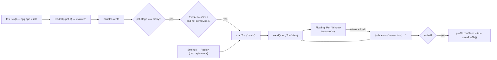

# Design Document

## Overview

The First-Run Tour is a short, one-time sequence of five pointer bubbles shown near
the floating pet right after it hatches for the first time. Each bubble explains one
interaction — feed, throw, hover, right-click menu, and the morning check-in — points
at the pet, and tracks the pet as it moves. The tour is skippable at any step, is
shown only once across the whole lifetime of the profile (surviving death, revival,
and new generations), and can be replayed on demand from the Hub's Settings tab.

The design mirrors the established Demo Mode pattern in this codebase, because the two
features share the same shape: a scripted, ordered sequence driven from `main.js` and
rendered as an overlay in the floating pet window. Two deliberate choices follow from
the project's rules:

- **The sequence lives in a pure module (`src/tour.js`)**, exactly like
  `src/demo-script.js` and `src/pet-state.js`: no Electron imports, plain data plus
  pure state-machine helpers, unit- and property-testable with plain Node. Only the
  copy *keys* live there; the actual strings live in `src/lines.js` as the project
  requires.
- **`main.js` owns only thin glue**: detecting the first hatch, reading/writing the
  seen-flag on the profile, pushing tour steps to the renderer over a new IPC channel,
  and handling replay and completion. The renderer owns the pointer-bubble overlay.

The "shown once" guarantee is anchored to a single persisted boolean on the
**profile** (`profile.tourSeen`), not the pet, because the profile survives death,
revival, retirement, and new eggs while the pet is reset each generation. This is the
same reasoning the codebase already uses for `profile.petdex`, `profile.checkins`, and
`profile.savedTabs`.

## Architecture

### Where the tour hooks in

The egg hatches in `fastTick()` in `main.js`: ~20 s after birth it bumps the pet's XP
to the baby threshold and calls `handleEvents(P.addXp(pet, 0), 'hatch')`. `addXp`
emits the `'evolved'` event, and `handleEvents` has a branch where
`pet.stage === 'baby'` — this is exactly "the egg just hatched into a baby" and is the
single detection point for First_Hatch. The tour trigger is gated there on
`!profile.tourSeen`.



### State ownership

- **`src/tour.js` (pure):** the ordered `TOUR_STEPS` (topic + line key + optional
  icon), and pure helpers `startState()`, `advance(state)`, `isLast(state)`,
  `stepFor(state)`, `TOTAL_STEPS`. The tour's "current index" is a plain number; the
  helpers never touch Electron or the DOM.
- **`main.js` (glue/state):** `let tourActive = false; let tourIndex = 0;`. It composes
  a **TourView** payload (index, total, topic, line text resolved via `say(...)`, and a
  `done` flag) and sends it on a new `'tour'` channel. It reads/writes
  `profile.tourSeen`.
- **`renderer/renderer.js` (view):** a `#tour` overlay element (bubble + pointer +
  "Next"/"Skip" buttons + "Step n of 5") that is positioned near the pet every frame
  in the existing `render(t)` loop, reusing the same edge-clamping helper (`shiftFor`)
  that keeps the speech bubble on screen.

### Why an overlay, not the speech bubble

The existing speech `#bubble` is a transient, queue-driven, auto-timed element with no
interactive controls. The tour needs persistent text with Next/Skip buttons and a
position that tracks the pet. So the tour gets its own small overlay (`#tour`), styled
to match, in the same spirit as the `#demo-caption` strip that Demo Mode added. The
tour overlay is the *only* part of the pet window that is intentionally interactive;
everywhere else the window stays click-through.

## Components and Interfaces

### `src/tour.js` (new, pure)

```js
// Ordered steps. Copy lives in src/lines.js under these keys; `line` is the key.
const TOUR_STEPS = [
  { id: 'feed',    line: 'tour-feed',    icon: 'food' },
  { id: 'throw',   line: 'tour-throw',   icon: 'star' },
  { id: 'hover',   line: 'tour-hover',   icon: 'heart' },
  { id: 'menu',    line: 'tour-menu',    icon: 'bell' },
  { id: 'checkin', line: 'tour-checkin', icon: 'bulb' },
];
const TOTAL_STEPS = TOUR_STEPS.length; // 5

function startState() { return { index: 0 }; }
function stepFor(state) { return TOUR_STEPS[state.index] || null; }
function isLast(state) { return state.index >= TOTAL_STEPS - 1; }
// advance returns a new state, or null when the tour is finished
function advance(state) { return isLast(state) ? null : { index: state.index + 1 }; }

module.exports = { TOUR_STEPS, TOTAL_STEPS, startState, stepFor, isLast, advance };
```

The module is intentionally tiny and pure so the "exactly five steps, fixed order,
advance/last/finish behaviour" can be proven by property tests without a running app,
exactly as `src/demo-script.js` proves its eight-step story.

### `src/lines.js` (edited)

Add the five tour keys (each ≤ 80 chars, following the existing array-of-candidates
shape). These are the single source of the on-screen copy; `main.js` resolves them
with `say(key)` when building the TourView. Example wording:

```js
'tour-feed':    ['Finish a task or commit code — that feeds me! 🍙'],
'tour-throw':   ['Grab me and fling me — drag and let go to toss! 🎉'],
'tour-hover':   ['Hover over me to peek at my meters. 💗⚡'],
'tour-menu':    ['Right-click me for tasks, focus, games and more.'],
'tour-checkin': ['Each morning I ask for your 3 tasks — that\'s check-in. ☀️'],
```

### `main.js` (edited glue)

- **State:** `let tourActive = false; let tourIndex = 0;` near the demo state.
- **`tourView()`:** builds the payload for the renderer:
  ```js
  function tourView() {
    const step = Tour.TOUR_STEPS[tourIndex];
    return step
      ? { active: true, index: tourIndex, total: Tour.TOTAL_STEPS,
          topic: step.id, icon: step.icon, text: say(step.line) }
      : { active: false };
  }
  ```
  `say(step.line)` is resolved once per step in main and sent as plain text, so the
  renderer never needs `lines.js`.
- **`startTour()`:** if a demo is playing, return. Set `tourActive = true; tourIndex = 0;`
  and `send('tour', tourView())`. Idempotent for replay: if already active, reset
  `tourIndex = 0` and re-send (Requirement 6.4).
- **`advanceTour()`:** `tourIndex += 1`; if `tourIndex >= TOTAL_STEPS` call `endTour()`,
  else `send('tour', tourView())`.
- **`endTour()`:** set `tourActive = false; tourIndex = 0;`
  `profile.tourSeen = true; saveProfile();` and `send('tour', { active: false })` to
  clear the overlay. Idempotent.
- **First-hatch hook:** in `handleEvents`, in the existing
  `e === 'evolved' && pet.stage === 'baby'` branch, after composing the hatch line add:
  `if (!demoMode && !profile.tourSeen) setTimeout(startTour, 1200);` (a short delay so
  the hatch burst plays first).
- **IPC (pet window):** `ipcMain.on('tour-action', (_e, a) => { ... })` where `a` is
  `'next'` → `advanceTour()`, `'skip'` → `endTour()`.
- **IPC (hub):** `ipcMain.handle('hub:replay-tour', () => { startTour(); return tasksView(); })`.
- **Notification safety:** `startTour`/`advanceTour`/`endTour` never call `notify(...)`
  (Requirement 7.3). Nothing in the tour path touches the notification seam.

### `preload.js` (edited — pet window bridge)

Add to the `bytepet` bridge:
```js
onTour: (cb) => ipcRenderer.on('tour', (_e, v) => cb(v)),
tourAction: (a) => ipcRenderer.send('tour-action', a),
```

### `preload-tasks.js` (edited — hub bridge)

Add to the `tasksApi` bridge:
```js
replayTour: () => ipcRenderer.invoke('hub:replay-tour'),
```

### `renderer/renderer.js` (edited — view)

- Register `api.onTour((v) => { tour = v.active ? v : null; renderTour(); })`.
- `renderTour()` builds/shows the `#tour` overlay when `tour` is active and hides it
  otherwise. It sets the text, the "Step n of 5" counter, the step icon (via
  `SP.icon(...)`), and the Next button label ("Next" or "Got it!" on the last step).
- In the per-frame `render(t)` loop, when `tour` is active, position `#tour` from
  `body.x/body.y` (anchored just above the pet, pointer aimed down at it) and clamp it
  on screen with the existing `shiftFor(...)` approach.
- The overlay's Next/Skip buttons call `api.tourAction('next' | 'skip')`. These buttons
  are the one interactive region the window adds; the existing hover/`setIgnoreMouse`
  logic already lets the pet body receive clicks, and the overlay will be included in
  the "hovering" hit region so clicks reach its buttons. Everywhere else stays
  click-through (Requirement 7.2).

### `renderer/index.html` (edited)

Add `<div id="tour" hidden>…</div>` next to the existing `#demo-caption` strip, with
child nodes for the pointer, text, counter, and the Next/Skip buttons. No inline
scripts; only `data:`-safe sprite images and `'self'` resources, matching the window's
CSP (Requirement 3.4).

### `renderer/tasks.html` (edited — Hub Settings)

In the Settings tab's "Help" row (where `#s-setup`, `#s-debug`, `#s-log` live), add:
```html
<button type="button" id="s-replay-tour">Replay the intro tour</button>
```

### `renderer/hub.js` (edited)

Bind the button next to the other Help-row buttons:
```js
$('s-replay-tour').addEventListener('click', () => api.replayTour());
```

## Data Models

### TourView (main → pet window, `'tour'` channel)

| Field  | Type     | Meaning                                              |
|--------|----------|------------------------------------------------------|
| active | boolean  | whether a tour is currently showing                  |
| index  | number   | 0-based index of the current step (when active)      |
| total  | number   | total steps (5)                                      |
| topic  | string   | step id: `feed`/`throw`/`hover`/`menu`/`checkin`     |
| icon   | string   | sprite icon name for the bubble                      |
| text   | string   | resolved copy from `lines.js` (≤ 80 chars)           |

### TourAction (pet window → main, `'tour-action'` channel)

A single string: `'next'` or `'skip'`.

### Profile field

| Field              | Type    | Default | Meaning                                   |
|--------------------|---------|---------|-------------------------------------------|
| `profile.tourSeen` | boolean | `false` | tour completed or skipped at least once   |

`tourSeen: false` is added to `emptyProfile()` in `src/progress.js`. Because
`loadProfile()` merges `{ ...emptyProfile(), ...saved }`, existing installs without the
field default to `false` and will see the tour once on their next first hatch — which
is acceptable and matches "shown once". No `DATA_VERSION` bump is needed.

## Step-to-interaction mapping

Each step's copy points the user at a real interaction that already exists in the
renderer/main:

| Step    | Real interaction it describes                                                        |
|---------|--------------------------------------------------------------------------------------|
| feed    | Finishing a task (`doFeed('task-*')`/`completeTask`) or a commit feeds the pet; there is no click-to-feed gesture. |
| throw   | `mousedown` → drag → `mouseup` computes `throwVelocity` and sets `body.vx/vy`.       |
| hover   | `mousemove` sets `hovering` and shows the `#panel` meters (`renderPanel`).           |
| menu    | `contextmenu` → `api.contextMenu()` → native `buildMenuTemplate()` popup.            |
| checkin | Morning check-in (`checkinPending`/`maybeAskCheckin`/`submitCheckin`): plan 3 tasks. |

The tour only *describes* these; it does not trigger them, so it stays passive and
non-interfering (Requirement 7).

## Error Handling

- **Replay while active (6.4):** `startTour()` resets `tourIndex = 0` and re-sends
  instead of starting a second tour.
- **Demo active (7.4):** `startTour()` early-returns while `demoMode` is true; the
  first-hatch hook is also gated on `!demoMode`.
- **End idempotency:** `endTour()` tolerates being called when no tour is active (e.g.
  a stray `skip`), simply ensuring the overlay is hidden and the flag is set.
- **Crash mid-tour (5.5):** because `profile.tourSeen` is only written on completion or
  skip, an unexpected exit mid-tour leaves the flag unset and the tour can appear again
  on the next first-hatch condition. This is intended.
- **Missing line key:** `say()` already returns a safe value; if a tour key were
  missing, the step still shows with empty text rather than crashing. Tests assert all
  five keys exist.

## Testing Strategy

Following the house style (`test/pet-state.test.js`, `test/demo-script.test.js`), the
pure `src/tour.js` is covered by property and unit tests run with plain Node + the
existing `fast-check` dev dependency. The main/renderer glue is covered by focused
example tests where a pure seam exists, and by a documented manual check where it does
not (the floating overlay DOM has no harness, same as the demo caption).

- **Property — exactly five steps, fixed order:** `TOUR_STEPS` has length 5 and the
  topics are `['feed','throw','hover','menu','checkin']` in that order.
- **Property — advancing walks every step once then finishes:** starting from
  `startState()`, repeatedly `advance` yields indices `0,1,2,3,4` and then `null`
  exactly at the fifth step (`isLast` true at index 4).
- **Property — copy bounds:** for every step, the resolved line from `lines.js` is a
  non-empty string of at most 80 characters, and every `TOUR_STEPS[i].line` key exists
  in `LINES`.
- **Property — seen-flag monotonicity:** a small pure model of `endTour` sets the flag
  and keeps it set; a pure "should auto-start" predicate
  `(tourSeen, demoMode, isFirstHatch)` returns true only when
  `!tourSeen && !demoMode && isFirstHatch`, covering 1.1–1.3, 5.3, 7.4.
- **Unit — exact wording:** representative keys resolve to the expected strings.
- **Manual/documented check:** overlay shows one bubble with a "Step n of 5" counter,
  Next advances, "Got it!"/Skip ends and hides the overlay, and the overlay tracks the
  pet and clamps on screen — verified in the running app, since the floating window has
  no DOM test harness.

All tests live in `test/` and run via `node test/pet-state.test.js` / the existing test
entry points, with zero failures, per the project's tech rules.
