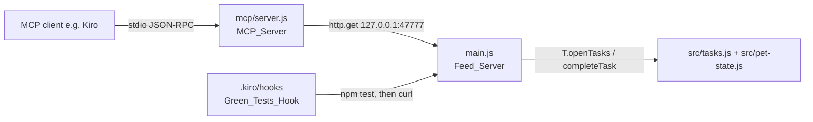

# Design Document

## Overview

This feature gives an AI agent a safe, on-device way to watch the pet and reward real work, and adds a Kiro hook that feeds the pet on a green test run. It is deliberately thin: all pet logic already lives in `src/pet-state.js` and `src/tasks.js`, and `main.js` already runs a local HTTP server (the Feed_Server) that git commits use. We extend that server with two task routes and put a small MCP server in front of it.

Three pieces:

1. **Feed_Server routes** (`main.js`) — add `GET /tasks` (list open tasks) and `GET /task/done?id=` (complete one). These reuse the existing `T.openTasks()` and `completeTask()` functions, so an MCP completion behaves identically to clicking a task in the tray or Tasks window — same food, same XP, same cross-app tick-off.
2. **MCP_Server** (`mcp/server.js`) — a standalone Node process speaking JSON-RPC 2.0 over stdio. It exposes three tools (`get_pet_status`, `list_open_tasks`, `complete_task`) that each make one `http.get` to the Feed_Server. No Electron, no dependencies, localhost only.
3. **Green_Tests_Hook** (`.kiro/hooks/feed-pet-on-green-tests.json`) — a `command` hook on the `Stop` trigger that runs `npm test` and, on success, curls the Feed_Server's `/feed` route.

## Architecture



Key decisions and rationale:

- **MCP server is a client, not a second source of truth.** Rather than embedding pet state in the MCP process (which would drift from the running app), the MCP_Server calls the same localhost endpoint git already uses. The app stays the single owner of `pet.json` and `tasks.json`.
- **Reuse `completeTask()` verbatim.** The new `/task/done` route calls the existing `completeTask(id)`, so completing via an agent feeds the pet, grants XP, updates focus, checks the daily plan, and ticks the task off in Reminders/Todoist — all the side effects the app already guarantees — with zero duplicated rules.
- **Hand-rolled JSON-RPC, no SDK.** The MCP wire format over stdio is newline-delimited JSON-RPC. Implementing the three methods we need (`initialize`, `tools/list`, `tools/call`) in ~150 lines keeps the project's no-build-step, no-dependency promise. An SDK would add a dependency tree for very little.
- **Failures become tool content, not transport errors.** When the app is down, `tools/call` still returns a normal result with `isError: true` and a human-readable message, so the agent can say "start Bytepet first" instead of the MCP connection breaking.
- **Hook on `Stop`, command action.** The pet should be fed after the agent finishes a unit of work, not on every file save. `Stop` fires once per turn; the command runs the real suite and only feeds on exit 0. `|| true` and curl's `-m 2` keep a failed/absent app from blocking the session.

## Components and Interfaces

### Feed_Server routes — `main.js`

Added inside `startFeedServer()`'s request handler, after the existing `/status` branch:

- `GET /tasks` → `200` JSON array: `[{ id, title, size, due, source }]` from `T.openTasks(tasks)`.
- `GET /task/done?id=<id>`:
  - no `id` → `400 missing id`
  - unknown id → `404` `{ ok: false, error }`
  - open task → `completeTask(id)` then `200` `{ ok: true, id, title, size }`

### MCP_Server — `mcp/server.js`

A Node stdio server. Reads newline-delimited JSON-RPC from stdin, writes responses to stdout.

```js
// One http.get to the Feed_Server; JSON-parses the reply.
function request(pathname) { /* resolves JSON or text; rejects with a friendly msg on ECONNREFUSED/timeout */ }

const TOOLS = [ get_pet_status, list_open_tasks, complete_task ]; // names + JSON input schemas

async function callTool(name, args) {
  // get_pet_status  -> request('/status')
  // list_open_tasks -> request('/tasks')
  // complete_task   -> request('/task/done?id=' + id)
}
```

JSON-RPC methods handled: `initialize` (returns protocolVersion + serverInfo `bytepet`), `tools/list`, `tools/call`, and the `notifications/initialized` notification (ignored). Host/port come from `BYTEPET_HOST`/`BYTEPET_PORT`, defaulting to `127.0.0.1:47777`.

### MCP registration — `.kiro/settings/mcp.json`

```json
{
  "mcpServers": {
    "bytepet": {
      "command": "node",
      "args": ["mcp/server.js"],
      "disabled": false,
      "autoApprove": ["get_pet_status", "list_open_tasks"]
    }
  }
}
```

The two read-only tools are auto-approved; `complete_task` changes state, so it stays a manual approval.

### Green_Tests_Hook — `.kiro/hooks/feed-pet-on-green-tests.json`

```json
{
  "version": "v1",
  "hooks": [{
    "name": "Feed the pet when tests pass",
    "trigger": "Stop",
    "action": { "type": "command",
      "command": "npm test --silent >/dev/null 2>&1 && curl -s -m 2 \"http://127.0.0.1:47777/feed?type=task&size=M\" >/dev/null 2>&1 || true" }
  }]
}
```

## Testing Strategy

- The Feed_Server routes and MCP tools are I/O glue over already-tested pure logic (`src/tasks.js`, `src/pet-state.js`), so they are verified with a stdio smoke check: stub the Feed_Server on a spare port, drive the MCP_Server through `initialize` → `tools/list` → each `tools/call`, and assert the handshake, the three advertised tools, and each tool's result text. (The smoke script is run during development and not kept in the committed suite, since it spawns a process and binds a port.)
- `npm test` continues to cover the pure modules; this feature adds no new pure logic to `src/`.

## Notes

- No new logic lands in `src/`, so per the project's test rule there is nothing new to property-test there; the change is server plumbing plus an MCP adapter.
- The `/task/done` route is a `GET` to match the existing `/feed` and `/status` style and to keep the git-hook/curl pattern consistent; it is localhost-only and completes an already-user-owned task, so it carries no cross-site risk.
- Because `complete_task` mutates state, it is intentionally excluded from `autoApprove`.
