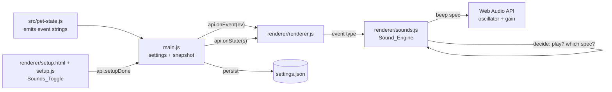

# Design Document

## Overview

Retro-sounds adds short, software-synthesized beeps to six pet events (hungry, sick, evolving, dying, reviving, basket). It reuses the exact Web Audio pattern already proven in `renderer/games.js` — an `AudioContext`, a square-wave `OscillatorNode`, and a `GainNode` — so no audio files are bundled or loaded (Requirement 1).

The feature is split into two responsibilities:

1. **A pure decision layer** — given the event type, the current `sounds` setting, and the latest state snapshot (`S`), decide *whether* to play and *which* beep spec to use. This is a plain function with no Web Audio dependency, so it is fully unit-testable without an `AudioContext` (Requirements 2, 3, 4).
2. **A thin playback layer** — given a beep spec, drive the oscillator/gain nodes. This mirrors the existing `beep(freq, ms)` helper and is wrapped in `try/catch` so a missing or unusable Web Audio API never interrupts the app (Requirement 1.5).

Wiring happens entirely in the renderer. `renderer/renderer.js` already receives events via `api.onEvent` and state via `api.onState`, and already gates speech bubbles on `S.quiet`. Sounds are gated the same way. The main process gains a `sounds` boolean setting that follows the existing `notifications`/`toasts` pattern and is carried to the renderer in the state snapshot. The setup window gets one more toggle alongside the existing `t-notify` checkbox.

## Architecture



Key decisions and rationale:

- **New dedicated module `renderer/sounds.js`.** The existing `beep` helper lives inside `renderer/games.js`, which is scoped to the mini-games window and pulls in game state. Rather than importing a games-window file into the pet window, the design extracts a small, self-contained module that mirrors the same oscillator/gain pattern. A dedicated module keeps the decision logic pure and unit-testable, satisfying the testability constraint.
- **Decision logic is pure and separate from playback.** `shouldPlay()` and `specFor()` take plain data (event type, settings flag, snapshot) and return plain data (a boolean, a spec object). They never touch `AudioContext`. This is what makes Requirements 2, 3, and 4 testable without a real audio device.
- **Gating reuses the renderer's existing rule.** The renderer already does `if (S && S.quiet && !IMPORTANT.has(type)) return;` for speech. Sounds use an equivalent, slightly stricter check (no `IMPORTANT` exception): play only when a snapshot exists, `S.sounds` is true, and `S.quiet` is false.
- **Setting travels in the snapshot, not via a separate channel.** `quiet` already rides in the snapshot and updates the renderer live. Putting `sounds` in the same snapshot means a runtime change applies to the next event with no extra IPC (Requirement 3.7).

## Components and Interfaces

### Sound_Engine — `renderer/sounds.js`

A small module exposing the pure decision functions plus a playback entry point. It is written so the decision functions can be required and tested in Node without a DOM/AudioContext (e.g. via `module.exports`, with a browser-global fallback for the renderer).

```js
// Beep specs: one per sound event. (See Data Models for values.)
const SPECS = { /* 'call-hungry': {...}, 'got-sick': {...}, ... */ };

// Pure: is this event one we sound, and are we allowed to play right now?
// state is the latest snapshot S (may be null before the first snapshot).
function shouldPlay(type, state) {
  if (!SPECS[type]) return false;        // R2.8: unmapped event -> no beep
  if (!state) return false;              // R4.4: no snapshot yet -> no beep
  if (state.sounds === false) return false; // R3.5: sounds off -> no beep
  if (state.quiet) return false;         // R4.1: quiet -> no beep, overrides sounds
  return true;                           // R3.6 / R4.2
}

// Pure: the beep spec for an event, or null if the event has none.
function specFor(type) {
  return SPECS[type] || null;
}

// Playback: synthesize the spec with Web Audio. Guarded so a missing or
// broken audio context is a no-op (R1.5). Stops any in-flight beep first (R2.9).
function playSpec(spec, ctx) { /* oscillator + gain envelope */ }

// Convenience used by the renderer: decide, then play.
function handleEvent(type, state) {
  if (!shouldPlay(type, state)) return false;
  playSpec(specFor(type));
  return true;
}
```

Interface contract:

| Function | Input | Output | Purpose |
| --- | --- | --- | --- |
| `shouldPlay(type, state)` | event string, snapshot or null | boolean | Pure gate (R2.8, R3.5, R4.1, R4.4) |
| `specFor(type)` | event string | spec object or null | Pure event→beep mapping (R2.1–2.6, 2.8) |
| `playSpec(spec, ctx?)` | spec, optional AudioContext | void | Web Audio playback (R1.1–1.5, R2.9) |
| `handleEvent(type, state)` | event string, snapshot | boolean (played?) | Decide-then-play used by renderer |

Playback mirrors the existing `renderer/games.js` helper: a lazily created `AudioContext`, `type = 'square'`, a `GainNode` set low (≈0.05), and `o.stop(ctx.currentTime + ms/1000)`. It adds a short gain ramp to 0 before the stop so playback ends without a click (R1.3), and it tracks the current oscillator so a new event can stop the previous one (R2.9). The whole body is wrapped in `try/catch` so that if `AudioContext` is undefined or throws, the call is a silent no-op (R1.5).

### Renderer wiring — `renderer/renderer.js`

The renderer requires/loads the sound module once, then calls it from the existing `api.onEvent` handler. The sound call is placed early in the handler, driven by the raw event type, so it fires for `call-hungry` and `got-sick` even though those types have no visual branch in the current `if/else` chain.

```js
// near the other module imports / globals
const Sound = window.Sounds; // or require, matching how renderer loads modules

api.onEvent((ev) => {
  const t = ev.type;
  Sound.handleEvent(t, S);   // S is the latest snapshot (null before first onState)
  // ... existing visual effect branches unchanged ...
  sayLine(ev.line, t);
});
```

`S` is the module-level snapshot already maintained by `api.onState((s) => { S = s; ... })`. Passing `S` gives the sound engine both the live `sounds` and `quiet` flags, and `S` is `null` until the first snapshot arrives (R4.4).

Event→label mapping confirmed against `src/pet-state.js`:

- hungry → `call-hungry` — emitted by `tickMinute` as `call-${need}` with `need === 'hungry'`. (There is no `call-sick`; sickness is a separate event.)
- sick → `got-sick` — emitted directly by the sickness transition.
- evolving → `evolved`; dying → `died`; reviving → `revived` — emitted directly by the stage/health transitions.
- basket → `basket` — emitted by the basket-catch action.

### Main-process setting — `main.js`

Follows the exact shape of the existing `notifications: true` / `toasts: true` booleans.

1. **Default.** Add `sounds: true` to `DEFAULT_SETTINGS`, next to `notifications`/`toasts` (R3.1). Because `loadSettings` does `{ ...DEFAULT_SETTINGS, ...(saved || {}) }`, a missing stored value resolves to `true` (R3.2).
2. **Snapshot.** Add `sounds: settings.sounds !== false` to the `snapshot()` object, next to the existing `quiet:` line (R3.4). The `!== false` form means any non-boolean/unreadable stored value still presents as `true` to the renderer, matching how `toasts`/`notifications` are read elsewhere (R3.3).
3. **Persist from setup.** In `saveHubSettings(input)`, add `if ('sounds' in input) settings.sounds = !!input.sounds;` next to the `notifications`/`toasts` lines. `finishSetup` already calls `saveHubSettings` then `saveSettings()`, which writes `settings.json` (R5.5). `writeJson` failure leaves the handler without mutating the on-disk file beyond its own atomic write, so a failed write does not partially corrupt other settings (R5.6).

### Setup UI — `renderer/setup.html` + `renderer/setup.js`

HTML: add one checkbox to the rhythm step's `.toggles` section, directly after the existing `t-notify` label, with a visible label (R5.1):

```html
<label><input type="checkbox" id="t-sounds" /> <span><b>Sound effects</b><small>Little retro beeps when your pet needs you (never during quiet hours)</small></span></label>
```

JS, in `setup.js`:

- In `api.get().then(...)`, set the checkbox from the loaded value: `$('t-sounds').checked = s.sounds !== false;` (R5.2, R5.3 — undefined resolves to checked).
- In the `api.setupDone({...})` payload, add `sounds: $('t-sounds').checked,` next to `notifications:` (R5.4).

## Data Models

### Beep spec

Each sound event maps to one spec. A spec is either a single tone or a short sequence of tones (for events that deserve a more distinctive sound). Durations are per-tone; total durations stay within the 80–400 ms window of R1.2. Each tone plays as a square wave through a gain node with an end-of-tone ramp to 0 (R1.3).

```ts
type Tone = { freq: number; ms: number };      // one square-wave note
type BeepSpec = { tones: Tone[] };              // played in sequence
```

### Event → beep spec table

The six specs are chosen so every pair differs by at least one of: base frequency ≥ 20 Hz apart, total duration ≥ 40 ms apart, or a different number of tones (R2.7). All total durations are within 80–400 ms (R1.2).

| Sound event | Pet_Event string | Tones (freq Hz × ms) | Base freq | Tone count | Total ms | Character |
| --- | --- | --- | --- | --- | --- | --- |
| hungry | `call-hungry` | 440×120 | 440 | 1 | 120 | single mid "ping" |
| sick | `got-sick` | 300×90, 230×140 | 300 | 2 | 230 | downward "uh-oh" |
| evolving | `evolved` | 523×90, 659×90, 784×120 | 523 | 3 | 300 | rising triad fanfare |
| dying | `died` | 200×140, 120×220 | 200 | 2 | 360 | low descending "power-down" |
| reviving | `revived` | 392×100, 523×100, 659×140 | 392 | 3 | 340 | rising "power-up" |
| basket | `basket` | 660×80 | 660 | 1 | 80 | quick high "blip" |

Distinctness check against R2.7 (each pair differs on ≥1 axis):

- Single-tone pair hungry (440/120/1) vs basket (660/80/1): base freq differs by 220 Hz and duration by 40 ms. ✓
- Two-tone pair sick (300/230) vs dying (200/360): base freq differs by 100 Hz and total by 130 ms. ✓
- Three-tone pair evolving (523/300) vs reviving (392/340): base freq differs by 131 Hz and total by 40 ms. ✓
- Any pair with different tone counts differs by the tone-count axis. ✓

The table lives in `renderer/sounds.js` as the `SPECS` object keyed by Pet_Event string, so `specFor` is a direct lookup and the mapping is testable as data.

## Correctness Properties

*A property is a characteristic or behavior that should hold true across all valid executions of a system — essentially, a formal statement about what the system should do. Properties serve as the bridge between human-readable specifications and machine-verifiable correctness guarantees.*

The pure decision layer (`shouldPlay`, `specFor`) and the `SPECS` data table carry the properties below. Playback shape (oscillator/gain construction, the gain ramp, interrupt-on-new-event) and all settings/UI wiring are verified by example and integration tests in the Testing Strategy instead, since they assert implementation structure or one-shot behavior rather than input-varying logic.

### Property 1: Each sound event maps to its own beep spec

*For any* of the six Pet_Event strings (`call-hungry`, `got-sick`, `evolved`, `died`, `revived`, `basket`), `specFor` returns a non-null spec, and the specs returned for the six events are pairwise distinct entries (no two events share the same spec object).

**Validates: Requirements 2.1, 2.2, 2.3, 2.4, 2.5, 2.6**

### Property 2: All six beeps are mutually distinguishable

*For any* pair of two different sound events, their beep specs differ on at least one axis: base (first-tone) frequency differing by at least 20 Hz, total duration differing by at least 40 ms, or a different number of tones.

**Validates: Requirements 2.7**

### Property 3: Every beep fits the duration window

*For any* spec in the `SPECS` table, the sum of its tone durations is between 80 and 400 milliseconds inclusive.

**Validates: Requirements 1.2**

### Property 4: The play gate honors mapping, setting, quiet, and snapshot presence

*For any* event string and *any* snapshot value (including `null`), `shouldPlay(type, state)` returns `true` if and only if all of these hold: `type` is one of the six sound events, `state` is non-null, `state.sounds` is not `false`, and `state.quiet` is falsy. In particular: an unmapped event never plays; a `null` snapshot never plays; `sounds === false` never plays; and `quiet === true` never plays even when `sounds` is `true`.

**Validates: Requirements 2.8, 3.5, 3.6, 3.7, 4.1, 4.2, 4.3, 4.4**

### Property 5: Playback never throws when Web Audio is unavailable

*For any* spec in the `SPECS` table, calling `playSpec` with a missing or throwing audio context completes without raising an exception and without side effects on the application.

**Validates: Requirements 1.5**

## Error Handling

- **Web Audio unavailable (R1.5).** `AudioContext` may be undefined or may throw on construction in some environments. `playSpec` lazily creates the context and wraps the entire synthesis body in `try/catch` (the same `catch { /* no sound */ }` pattern used by the existing `renderer/games.js` helper). On any failure the call is a silent no-op; the event's visual effect and speech bubble still proceed because the sound call runs before and independently of them in `onEvent`.
- **No snapshot yet (R4.4).** Before the first `api.onState`, the renderer's `S` is `null`. `shouldPlay` treats `null` as "do not play", so an early event produces no sound rather than a crash on `S.quiet`/`S.sounds` access.
- **Unmapped events (R2.8).** `specFor`/`shouldPlay` return `null`/`false` for any event outside the six, so the sound call is harmless for the many other event types flowing through `onEvent`.
- **Setting persistence failure (R5.6).** `saveSettings` → `writeJson` performs the on-disk write. If it fails, the in-memory `settings` object is still consistent and no partial rewrite of unrelated keys occurs; the previously stored `settings.json` is left as-is. Setup submission does not assume the write succeeded for correctness of the running session.
- **Unreadable stored `sounds` value (R3.3).** The snapshot reads `settings.sounds !== false`, so any missing or non-boolean stored value surfaces to the renderer as `true` without disturbing other loaded settings.

## Testing Strategy

The feature is designed for `npm test`. The decision layer and spec table in `renderer/sounds.js` are pure and exported so they can be required in Node without a DOM or `AudioContext`. Playback is tested with a stubbed context.

### Property-based tests

Use a property-based testing library for the project's JavaScript test runner (e.g. `fast-check`) — do not hand-roll generators. Each property test runs a minimum of 100 iterations and is tagged with a comment referencing its design property.

Tag format: **Feature: retro-sounds, Property {number}: {property_text}**

- **Property 1 (mapping).** Generate from the set of six event strings; assert `specFor(e)` is non-null and that the six results are pairwise distinct. (Enumeration-backed generation is fine; the 100-iteration minimum still applies.)
- **Property 2 (distinctness).** Generate unordered pairs of the six events; assert the freq/duration/tone-count disjunction holds.
- **Property 3 (duration window).** Generate over the spec table entries; assert total duration ∈ [80, 400].
- **Property 4 (gating).** Generate `type` from a mix of the six sound events and arbitrary non-sound strings, `sounds` ∈ {true, false, undefined, null}, `quiet` ∈ {true, false}, and `state` ∈ {generated snapshot, null}. Assert `shouldPlay` equals the reference predicate `isSoundEvent(type) && state != null && state.sounds !== false && !state.quiet`.
- **Property 5 (playback robustness).** Generate over the spec table; call `playSpec(spec, ctx)` where `ctx` is `null` or a stub whose methods throw; assert no exception propagates.

### Unit / example tests

- **R1.1, R1.3, R2.9 (playback shape):** stub the audio context. Assert `playSpec` creates a square-wave oscillator and a gain node, connects to destination, schedules a gain ramp to 0 before the stop time, and — on a second event while one is playing — stops the previous oscillator before starting the new one.
- **R2.8 (renderer wiring):** feeding a non-sound event through the handler path triggers no playback.
- **R3.1–R3.4 (main settings):** `DEFAULT_SETTINGS.sounds === true`; loading settings without a `sounds` key yields `true`; `snapshot()` output includes `sounds`; a stored `false` surfaces as `false` while unrelated keys are retained.
- **R5.1–R5.4 (setup UI):** `#t-sounds` exists with a visible label; checkbox reflects `s.sounds` (true/undefined → checked, false → unchecked); `setupDone` payload carries `sounds` matching the checkbox.
- **R5.5–R5.6 (persistence):** `saveHubSettings({ sounds: false })` sets `settings.sounds = false` and writes; with a throwing `writeJson` stub, other settings are not partially corrupted.

### Integration smoke

- **R1.4:** a static check that `renderer/sounds.js` references no external audio files and performs no file/network loading.
- End-to-end sanity: dispatch each of the six events through the renderer handler with a snapshot where `sounds: true, quiet: false` and confirm `handleEvent` returns `true` (played) for all six and `false` when `quiet` or `sounds` suppresses them.
