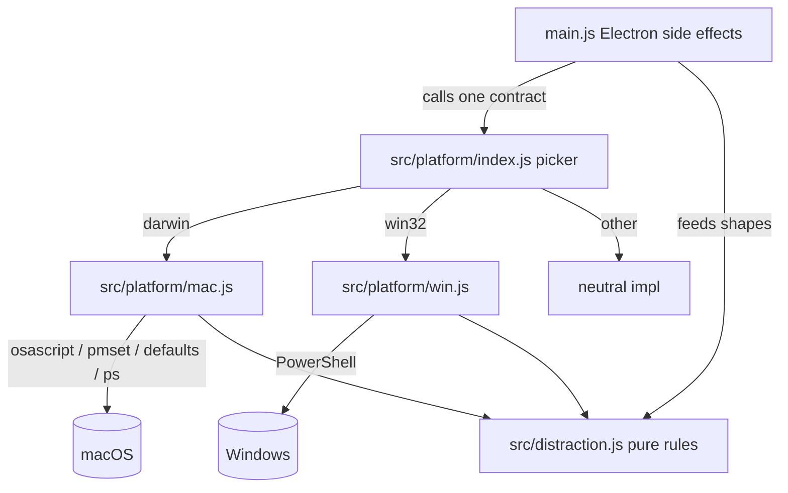

# Design Document

## Overview

Bytepet turns your real work habits into pet behaviour. Everything it reads from the computer — the foreground app, what else is running, the active browser tab, every open tab, software updates, battery, digital mess, music — is done today with macOS-only mechanisms (JXA/AppleScript via `osascript`, `pgrep`, `ps`, `pmset`, `softwareupdate`, `defaults`, `brew`, and Mac paths), guarded by a single `IS_MAC = process.platform === 'darwin'` check in `src/system.js` and `main.js`. On any non-Mac platform those reads already fall back to neutral values, so Bytepet launches on Windows but is inert.

This design makes Bytepet a first-class Windows app **without changing any Mac behaviour**. The core move is a **platform layer**: `src/platform/index.js` picks `src/platform/mac.js` or `src/platform/win.js` from `process.platform` and re-exports one stable contract. Today's Mac reads move verbatim into `mac.js`; a new `win.js` implements the same contract using what Windows offers (PowerShell for the active window, process list, Windows Update, and Recycle Bin; browser **window-title** matching instead of per-tab AppleScript; **minimising** the distracting window instead of closing tabs). `main.js` stops calling OS mechanisms directly and calls the contract instead.

Two facts from the code shape the design and keep risk low:

1. **The pet window is already a full-screen transparent overlay sized to `screen.getPrimaryDisplay().workArea`.** The renderer derives the pet's floor from `window.innerHeight` (`floorY = () => window.innerHeight - body.size`). Because `workArea` already excludes the taskbar/dock on both platforms, the floor sits above the taskbar for free — on any edge — as long as the overlay tracks the correct display's `workArea`. The only gap is multi-monitor: today it is hardcoded to the primary display.
2. **Lock, unlock, suspend, resume, and idle already come from Electron `powerMonitor`** on both platforms. Only battery/charging (via `pmset`) and thermal reading (`getCurrentThermalState`) are Mac-mechanism pieces. So Requirement 8 is a small, targeted change, not a rewrite.

No application build step is added. The platform layer is plain `require()`-able JS; `npm start` still runs the source directly. The only new build step is packaging the Windows installer with electron-builder, mirroring the existing `@electron/packager` Mac build.

### Mechanism choice for Windows reads: PowerShell, not a native module

For the active window and process list, the obvious npm option is `active-win` / `get-windows`, but those ship **native binaries** that need prebuilds per Electron ABI and muddy the project's "no build step / plain JS" ethos and CI. Instead, `win.js` uses **PowerShell** as the primary mechanism for every Windows read (active window, running processes, Windows Update, Recycle Bin). PowerShell is present on every supported Windows version, needs no compilation, needs no admin for these reads, and keeps `win.js` as pure-ish "run a command, parse its text output" code — exactly the shape `src/system.js` already has, and exactly the shape the parsing tests want. The design keeps the mechanism isolated behind the contract so a native package could be swapped in later without touching `main.js`.

### One persistent PowerShell, not one per check

Spawning a fresh `powershell.exe` on the 5-second loop is too slow and heavy: process startup alone is roughly 0.5–1s, and `Add-Type` for the user32 `GetForegroundWindow` P/Invoke compiles C# on every launch. So the frequent Windows reads use **one long-running hidden PowerShell host** started at launch:

- Start once: `powershell.exe -NoProfile -NonInteractive -ExecutionPolicy Bypass -Command -` with `{ windowsHide: true }`, so it reads commands from **stdin** and writes replies to **stdout**. Run `Add-Type` for the user32 P/Invoke **once** at startup, so the C# is compiled a single time.
- Each 5-second check sends **one** "snapshot" command and reads **one** JSON reply. The snapshot returns the **foreground window (handle, title, pid) + the windowed process list (name, path, title)** together, so a whole check is a single stdin→stdout round trip rather than three process spawns. `win.js`'s `frontApp()`, `runningApps()`, `frontWindowTitle()` and the browser-title read all derive from the one cached snapshot for that tick.
- Framing: each command writes a unique end-of-reply sentinel line (e.g. `<<<BYTEPET_END>>>`); the reader accumulates stdout until it sees the sentinel, then `JSON.parse`s the block. A monotonically increasing request id guards against a stale reply being matched to a new request.
- Safety / liveness: if the host process exits, errors, or a reply does not arrive within ~3 seconds, `win.js` kills and restarts the host and returns the **Neutral_Value** for that check (never blocks, never throws, never crashes the pet). A backoff caps restart attempts so a permanently broken host can't spin.
- Lifecycle: the host is started lazily on the first Windows read and torn down on `before-quit`. On macOS this host is never created.

This is the Windows twin of Mac's cheap `osascript` calls: the per-tick cost becomes one small pipe write + read instead of a process launch and a C# compile.

### Windows Update runs rarely, in its own short-lived process

A Windows Update search can take **minutes** and must never sit on the 5-second loop or inside the persistent host (it would block every other check). So `pendingUpdates()` on Windows:

- Runs in a **separate, short-lived** `powershell.exe` call (not the persistent host), with its own generous timeout.
- Is invoked **only at startup and every 60 minutes**, matching the cadence `main.js` already uses for its periodic update check — not on the 5-second sampler.
- On any failure, timeout, unavailability, or unparseable output returns `[]` (zero updates), so a slow or failed check never wrongly sickens the pet.

The Recycle Bin count (also a short-lived separate call) runs on the existing mess cadence (every 30s / 60s on battery), not the 5-second loop, so it likewise stays off the hot path.

## Architecture

### The platform layer

```
src/platform/
  index.js   Platform_Picker: choose impl from process.platform; expose the contract
  mac.js     Mac_Impl: today's src/system.js + the Mac reads currently in main.js
  win.js     Win_Impl: PowerShell-based Windows implementation
  neutral.js (optional) the all-neutral fallback, or built inline in index.js
```

`src/system.js` is retained as a **thin compatibility shim** that re-exports the platform layer, so any `require('./src/system')` keeps working during and after the move. (Alternatively `main.js` is updated to `require('./src/platform')` directly; either way the parser tests that currently import `src/system` keep passing.) This shim is what makes Requirement 2.5's "existing parser tests pass unchanged" true with minimal churn.



### The picker

```js
// src/platform/index.js
function pick(platform = process.platform) {
  if (platform === 'darwin') return require('./mac');
  if (platform === 'win32') return require('./win');
  return require('./neutral');
}
module.exports = pick();              // default: current platform
module.exports.forPlatform = pick;    // testable: forPlatform('win32') etc.
```

`forPlatform` is the explicit-platform path required by Requirement 1.5 and 12.1, so the Mac host can exercise the `win32` and `darwin` selection branches in tests. `require` is memoised by Node, so this is cheap.

### How `main.js` consumes the contract

`main.js` keeps all Electron side effects (windows, tray, notifications, saving, speech) and all the orchestration logic (sampling cadence, focus sessions, medicine watch, mess application). It changes only at the **read boundary**: the functions that currently shell out move behind the contract. The pure `src/distraction.js` and `src/pet-state.js` are untouched — both platforms feed them the same shapes.

## The platform contract

Every function returns its Neutral_Value on any error/timeout/missing capability and never throws (Requirement 9). Shapes are exactly today's shapes (Requirement 2.2).

| Function | Args | Returns | Neutral value |
|---|---|---|---|
| `frontApp()` | – | `{ name, bundlePath, category, self }` | `{ name: null, bundlePath: null, category: null, self: false }` |
| `runningApps()` | – | `[{ name, bundlePath, policy }]` | `[]` |
| `appInfo(bundlePath)` | path | `{ category, agent }` | `{ category: null, agent: false }` |
| `activeTab(appName)` | browser name | `{ site, title }` or `null` | `null` |
| `allTabs(browser, kind)` | name, `'safari'`\|`'chromium'` | `[{ browser, site, title }]` or `null` | `null` |
| `browserTabs(...)` | (see below) | `[{ browser, site, title }]` | `[]` |
| `frontWindowTitle()` | – | `string` or `null` | `null` |
| `hideApp(target)` | bundlePath / exe / window id | `boolean` | `false` |
| `closeTabs(browser, kind, hosts, learning)` | – | `[{ url, title }]` | `[]` |
| `battery(powerMonitor)` | powerMonitor | `{ percent, pluggedIn, charging, onBattery }` or `null` | `null` |
| `heat(powerMonitor)` | powerMonitor | `{ thermal, load, hot }` | `{ thermal:'unknown', load, hot:false }` |
| `messCounts(limits)` | limits obj | `[{ kind, label, count, limit }]` | `[]` |
| `pendingUpdates(settings)` | settings | `string[]` or `null` | `[]` (zero, see note) |
| `musicPlaying(apps)` | app names | `boolean` | `false` |
| `openMessFolder(kind)` | `'desktop'`\|`'downloads'`\|`'trash'` | opens folder | no-op |
| `openUpdates()` | – | opens OS update UI | no-op |
| `permissionPanes` / `openPane(kind)` | – | opens settings UI | no-op |

Note on `pendingUpdates`: today Mac returns `null` on hard failure and `main.js` treats `mac===null && brew===null` as "could not check" (no sickness change). On **Windows**, per Requirement 6.2, a failed/unavailable/unparseable check returns a result equivalent to **zero** updates (`[]`), so the pet is never wrongly made sick — Windows never returns `null` from `pendingUpdates`.

## The Mac implementation (`mac.js`)

`mac.js` carries the existing behaviour unchanged. The functions moving into it, and where they come from today:

**From `src/system.js` (moved as-is):**
`countItems`, `countTabs`, `checkMess` → `messCounts`, `battery`, `heat`, `frontWindowTitle`, `parseRunningApps`, `parseWorkspaceApps`, `runningApps`, `allTabs`, `hideApp`, `closeTabs`, plus the `run()` helper, `TAB_BROWSERS`, `TAB_SCRIPTS`, `WORKSPACE_SCRIPT`, and the `titleDeniedUntil` back-off state.

**From `main.js` (moved behind the contract):**
- `getFrontAppInfo` (+ `FRONT_SCRIPT`, lsappinfo fallback) → `frontApp`
- `appInfo` / `appCategory` (+ `appInfoCache`) → `appInfo`
- `getBrowserTab` (+ `BROWSERS`, `browserDenied`, `browserStatus`) → `activeTab`
- `checkMusic`'s `pgrep`+`osascript` core → `musicPlaying`
- `countMacUpdates` + `countBrewUpdates` + `quickUpdateCount` → `pendingUpdates` (and a `quickUpdateCount` helper the medicine watcher can keep calling through the contract)
- `openSoftwareUpdate` → `openUpdates`
- `openMess`'s folder paths (`Desktop`, `Downloads`, `.Trash`) → `openMessFolder`
- `PANES` + `setup:fix` deep links + `isTrustedAccessibilityClient` → `permissionPanes` / `openPane`
- the `pgrep` "tempted" background check in `sample()` → a small `isRunning(name)` contract helper

The design will keep the exact caching and back-off (`appInfoCache`, `browserDenied` 10-min window, `titleDeniedUntil` 15-min window) in `mac.js` so Mac CPU and permission-prompt behaviour is identical (Requirement 2.4). `main.js` keeps calling the same names via the contract; only the module they live in changes.

Verification for Requirement 2.6: run `npm test` immediately **before** the move (record the pass count) and immediately **after** the move and the `main.js` rewiring, confirming both are green with zero failures. The task list makes this an explicit gate. The "functions that moved" list above is the one Requirement 2.6 asks the design to carry.

## The Windows implementation (`win.js`)

Windows reads come from two mechanisms:

1. **The persistent host** (described above) for the frequent reads on the 5-second loop: the foreground window, the windowed process list, and all window titles. One `snapshot()` round trip per tick feeds `frontApp()`, `runningApps()`, `frontWindowTitle()`, and the browser-title read from a single cached reply.
2. **Short-lived `ps(script, timeout)` calls** for the rare/slow reads off the hot path: `pendingUpdates()` (startup + hourly) and the Recycle Bin count (mess cadence). `ps` runs `powershell.exe -NoProfile -NonInteractive -ExecutionPolicy Bypass -Command <script>` via `execFile` with `{ windowsHide: true }` and a bounded timeout, resolving `{ err, out }` (never rejects).

Every public function wraps its read in parse + try/catch and returns the Neutral_Value on any failure, host death, or timeout.

Each Windows read is split into **(a)** a host snapshot or `ps` call and **(b)** a **pure Parsing_Function** that takes the raw string and returns the contract shape. The Parsing_Functions are exported so tests feed them sample output and never invoke PowerShell (Requirement 12.5).

### The snapshot (one round trip per tick)

The host runs a `Snapshot` function (defined once at startup alongside the `Add-Type` user32 P/Invoke) that returns a single JSON object:

```
{ "front": { "pid": <n>, "title": "<s>", "name": "<s>", "path": "<s>" },
  "apps":  [ { "pid": <n>, "name": "<s>", "path": "<s>", "title": "<s>" }, ... ] }
```

- `front` comes from `GetForegroundWindow()` → `GetWindowThreadProcessId()` → the owning process's `ProcessName`/`Path`/main-window title.
- `apps` is `Get-Process` filtered to processes with a non-zero `MainWindowHandle` (a visible top-level window) — the Windows analogue of Mac's "apps with a Dock icon" (activation policy 0), so background services aren't treated as apps.

`parseSnapshot(json)` returns `{ front, apps }` in normalised form; empty/malformed input yields `{ front: null, apps: [] }`. All four frequent contract functions are thin selectors over the current tick's parsed snapshot.

### `frontApp()` — the foreground window

From the snapshot's `front`. `parseFrontApp` (or the `frontApp` selector over `parseSnapshot`) returns:
- `name`: the process's name (e.g. `chrome`, `Code`), normalised so the existing work-app / distraction-app lists match (see "Name normalisation").
- `bundlePath`: the executable path.
- `category`: `null` (Windows has no `LSApplicationCategoryType`). Category-based auto-detection (any game/entertainment/social app) is therefore macOS-only; Windows relies on the app/site/keyword lists plus window titles, which is acceptable per Requirements 3.1 and 4.
- `self`: `true` when the exe path is Bytepet's own (`process.execPath`), mirroring the Mac `self` check so the sampler looks past its own window.

### `runningApps()` — what else is open

From the snapshot's `apps`. `parseRunningApps(json)` returns `[{ name, bundlePath, policy: 0 }]`. Filtering to windowed processes (done in the snapshot) is the Windows analogue of Mac's Dock-icon apps, matching how `decideBackground` expects real apps.

### Browser activity — window titles only

Windows has no AppleScript tab API. So on Windows:
- `activeTab()` returns `null` always (no per-tab URL). The front browser's **window title** is read via `frontWindowTitle()` instead.
- `frontWindowTitle()` returns the foreground window's title from the snapshot's `front.title`. `main.js` already falls back to `frontWindowTitle()` when a browser gives no site — on Windows that path is simply always taken for browsers.
- `browserTabs()` (the every-window equivalent of `allTabs`) returns the titles of all browser windows from the snapshot's `apps`, shaped as `[{ browser, site: null, title }]`, so `decideBackground`'s title/keyword matching can flag a distracting background browser window. `site` is deliberately `null` — never fabricated (Requirement 4.5), so a title that doesn't match a keyword cannot cause a false `site` distraction.

Matching reuses `src/distraction.js` exactly (Requirement 4.4): `decide` already checks `titleHas(title, distractionKeywords)` and the learning exemption via `titleHas(title, learningKeywords)`. The default `distractionKeywords` (`YouTube`, `Netflix`, `Reddit`, …) and `titleCheckApps` already exist for the Mac Firefox case, so Windows browsers get the same treatment with no new matching code. The design will make sure Windows browser process names (`chrome`, `msedge`, `firefox`, `brave`, `opera`, `vivaldi`, `arc`) are recognised as browsers so their titles are checked.

```mermaid
flowchart LR
  FW[PowerShell: foreground window + title] --> PA[parseFrontApp]
  AW[PowerShell: windowed processes + titles] --> PR[parseRunningApps / parseBrowserTitles]
  PA --> |{name,bundlePath,category:null,self}| DEC[distraction.decide]
  PR --> |apps + title-only tabs| DECB[distraction.decideBackground]
  DEC --> V[verdict]
  DECB --> V
```

### `hideApp()` and `closeTabs()` — strict focus

- `hideApp(target)` minimises the target's window by sending a `Minimize <pid|path>` command to the **persistent host**, which calls `ShowWindowAsync(hWnd, SW_MINIMIZE)` (the user32 P/Invoke is already loaded) for the process whose exe path or name matches `target`. Returns `true` if at least one window was minimised (Requirements 5.1, 5.2). Reusing the host means no extra process spawn and no re-compile for the common strict-focus action.
- `closeTabs()` is a no-op returning `[]` (Requirement 5.3). `main.js`'s `enforceStrict` already treats browsers and non-browsers separately; on Windows the browser branch's `closeTabs` returns `[]`, and the design routes a distracting **browser window** through `hideApp` (minimise) instead, so strict focus still acts. The saved-tabs/reopen flow is simply never populated on Windows (empty list), which the existing code handles gracefully.

`main.js`'s `enforceStrict` gets a small platform-aware tweak: on Windows, a distracting browser is minimised via `hideApp` rather than queued for `closeTabs`. The Mac branch is untouched (Requirement 5.5).

### `pendingUpdates()` — Windows Update, failing to zero

Because a Windows Update search can take minutes, this runs in a **separate short-lived `ps` call** (never the persistent host, never the 5-second loop) with its own generous timeout, invoked only at startup and hourly. The script queries the Windows Update COM API:
```
(New-Object -ComObject Microsoft.Update.Session).CreateUpdateSearcher()
  .Search("IsInstalled=0 AND IsHidden=0").Updates | % { $_.Title }
```
`parseUpdates(out)` returns the titles as a string array. On **any** failure — COM unavailable, offline, elevation needed, timeout, or unparseable output — it returns `[]` (zero), never `null` (Requirements 6.2, 6.5). `main.js`'s medicine logic then sees zero and never sickens the pet wrongly; when it drops from some to zero, the existing `setUpdates(pet, 0)` cure runs (Requirement 6.4). There is no Homebrew analogue on Windows, so `checkHomebrew` is simply ignored.

`openUpdates()` opens the Windows Update settings page via `ms-settings:windowsupdate` (`shell.openExternal`).

### `messCounts()` — Desktop, Downloads, Recycle Bin

- Desktop and Downloads: counted with the existing `countItems` logic against `path.join(os.homedir(), 'Desktop')` and `path.join(os.homedir(), 'Downloads')` (Requirement 7.2). (`countItems` is platform-neutral and moves into a shared helper both impls use.)
- Recycle Bin: a short-lived `ps` call (on the mess cadence, not the 5-second loop) via the Shell.Application COM object (`(New-Object -ComObject Shell.Application).NameSpace(0xA).Items().Count`), parsed by `parseRecycleCount(out)` → number or `null` (Requirement 7.3).
- Tabs: omitted on Windows (no per-tab count available), so the tabs pile is simply absent rather than wrong (Requirement 7.4).
- Each pile is counted independently; a failure in one is caught and that pile skipped, the rest still returned (Requirement 7.5).
- `openMessFolder('trash')` opens the Recycle Bin via `shell:RecycleBinFolder`; `desktop`/`downloads` open the real folders (Requirement 7.6).

### `musicPlaying()`

Windows has no cross-app "player state" API as simple as AppleScript's. The design uses the Windows **Global System Media Transport Controls** (GSMTC) session state via PowerShell WinRT, parsed to a boolean "something is playing", run on the existing music cadence (every 8s) as a short-lived `ps` call. If it is unavailable or fails, it returns `false` (Neutral_Value) — dancing just won't trigger, which is harmless. This keeps `musicApps` meaningful where possible without a native dependency; the fallback is safe.

### `battery()` and `heat()` — via powerMonitor (Requirement 8)

Battery/charging moves off `pmset` to Electron's `powerMonitor` on **both** platforms. `main.js`'s `checkSystem()` already receives `powerMonitor`; the contract's `battery(powerMonitor)` returns:
- `charging` / `pluggedIn`: from `powerMonitor.onBatteryPower` (inverted) — `onBatteryPower === false` ⇒ plugged in. Electron exposes battery-power state and `on('on-battery')` / `on('on-ac')` events on both platforms.
- `onBattery`: `powerMonitor.onBatteryPower === true`.
- `percent`: Electron does not expose a battery percentage cross-platform. The low-battery reaction (`percent <= 20`) is kept **Mac-only** via `mac.js` (which can still read `pmset` for the percent), while the charging/plugged reaction works on both. On Windows `percent` is `null`, so `systemView().low` is driven only by charging state — the pet reacts to "on battery vs charging" on Windows, and additionally to "under 20%" on Mac. This preserves Mac behaviour exactly and gives Windows the charging/battery reaction (Requirements 8.1, 8.4).
- If `powerMonitor` can't report battery state, the device is treated as plugged in (Neutral_Value, Requirement 8.5), preserving "desktops count as plugged in" (Requirement 8.3).

`heat()` keeps using `powerMonitor.getCurrentThermalState()` where available (Mac) and `os.loadavg()` on both; on Windows thermal is `'unknown'` and `hot` is driven by CPU load only — the existing `heat()` already degrades this way, so no special-casing is needed.

Lock/unlock/suspend/resume and `getSystemIdleTime()` are already `powerMonitor` on both platforms and are left as-is (Requirement 8.2).

### Name normalisation

Mac reports friendly app names (`Google Chrome`); Windows reports process names (`chrome`, `Code`, `msedge`). The user's default `workApps`/`distractionApps` lists use Mac-style names. To make the lists work on Windows without forcing users to re-enter everything, `win.js` normalises common process names to the friendly names the lists expect (a small lookup: `chrome`→`Google Chrome`, `msedge`→`Microsoft Edge`, `Code`→`Visual Studio Code` already matches, etc.), and matching stays case-insensitive in `distraction.js`. Where no mapping exists, the raw process name is used. This is a Win_Impl concern only; `distraction.js` is unchanged.

## Electron shell changes in `main.js`

These are the cross-platform window/tray/notification/login items (Requirements 15–18).

### Floating pet window (Requirement 15)

The window options already produce a transparent, frameless, non-focusable, click-through overlay, and `setIgnoreMouseEvents(true, { forward: true })` + `focusable:false` work on Windows. The macOS-only extras (`setAlwaysOnTop(true,'floating')` level string, `setVisibleOnAllWorkspaces(..., { visibleOnFullScreen:true })`) are harmless no-ops on Windows and stay. One addition for Windows: set the window **icon** (Mac gets its icon from the app bundle; Windows needs an explicit `.ico`), and add `transparent`-overlay safety on Windows by keeping `skipTaskbar: true` (already set).

The real change is **multi-monitor / taskbar tracking**. Today `createWindow` and its `fit` closure use `screen.getPrimaryDisplay().workArea`. The design generalises the overlay to cover the correct display's `workArea` and to re-fit on display/metrics changes (already wired via `display-metrics-changed`, `display-added`, `display-removed`). Because the renderer derives the floor from `innerHeight`, aligning the overlay to `workArea` automatically puts the floor above the taskbar on bottom/top/left/right placements (Requirements 15.2, 15.3, 15.5). For multi-monitor, the overlay follows the display the pet is on; the simplest correct approach that preserves today's single-overlay model is to size the overlay to the display under the pet (or the primary) and re-fit on changes (Requirement 15.4). The Mac path keeps using the primary display's `workArea`, so Mac behaviour is unchanged (Requirement 15.6).

### Tray, notifications, login (Requirement 16)

- **Tray** already branches: `trayTemplate.png`+`setTemplateImage(true)` on Mac, `tray.png` on Windows. The design adds a proper `.ico` for the tray/window on Windows and verifies the right-click menu (the whole `buildMenuTemplate`) renders — it is plain Electron Menu API and platform-neutral (Requirements 16.1, 16.2, 16.3).
- **Notifications**: add `app.setAppUserModelId('com.bytepet.desktop')` in `whenReady` **before** any notification, so Windows toasts are attributed to Bytepet rather than "Electron" (Requirement 16.4). `notify()` otherwise unchanged (it already uses the Electron `Notification` class and `Notification.isSupported()`).
- **Open at login**: `setOpenAtLogin` uses `openAsHidden: true` (Mac-only). On Windows, pass `args: ['--hidden']` instead (and read that flag at startup to start hidden). The design branches `setOpenAtLogin` by platform; `app.getLoginItemSettings()`/`setLoginItemSettings()` are cross-platform (Requirement 16.5). Mac behaviour unchanged (Requirement 16.6).

### No Mac-only calls left in shared code (Requirement 17)

Every Mac shell/deep-link call listed in the Mac_Impl section moves behind the contract. After the move, `main.js` contains **no** `osascript`/`pmset`/`defaults`/`softwareupdate`/`pgrep`/`lsappinfo`/`x-apple…` usage; it calls `Platform.frontApp()`, `Platform.musicPlaying()`, `Platform.pendingUpdates()`, `Platform.openUpdates()`, `Platform.openMessFolder()`, `Platform.openPane()`, `Platform.isRunning()`. The git post-commit hook (`#!/bin/sh` + `curl`) is the one shared-code POSIX-ism; the design adds a Windows-compatible hook variant (a `.cmd`/PowerShell `curl`-equivalent, or `curl` which ships with modern Windows) written by `connectRepo` when on Windows. All paths already use `path.join`/`os.homedir()`; the design audits for any stray hardcoded POSIX path and fixes it (Requirement 17.2, 17.5).

### Shared subsystems unchanged (Requirement 18)

The feed server (`startFeedServer`, loopback `127.0.0.1:47777`, `feed-guard`), the MCP server (`mcp/server.js`, pure HTTP client, no Electron), demo mode (`src/demo-script.js`, pure), sounds (`renderer/sounds.js`, Web Audio), and save files (`app.getPath('userData')`) are already platform-neutral and are **not** modified. Their existing tests keep running (Requirement 18.6). The design's job here is to *not break* them — verified by the suite.

## Packaging (Requirements 10, 11)

### electron-builder Windows target

Add `electron-builder` as an exact-pinned devDependency and a `build` block (in `package.json` or `electron-builder.yml`) with an NSIS `win` target, product name "Bytepet", and a `.ico` icon under `assets/`. Add `build:win` → `electron-builder --win --x64`. The existing `build:mac` (`@electron/packager`) is left as the Mac path (Requirement 10.5); electron-builder is used only for the Windows installer, so the Mac build is untouched. No app build step is introduced — `npm start` still runs source; electron-builder only packages (Requirement 10.4).

A `.ico` is generated from `assets/icon.png` (the Mac `sips`/`iconutil` path is Mac-only; the `.ico` is produced by electron-builder's icon handling from a PNG, or checked in once).

### GitHub Actions release workflow

`.github/workflows/release-win.yml`: on release published (and `workflow_dispatch`), `runs-on: windows-latest`, `actions/setup-node`, `npm ci`, `npm run build:win`, then upload the resulting `.exe` as a release asset (`softprops/action-gh-release` or `gh release upload`). If the build fails the job fails (non-zero exit), so no empty artifact is published (Requirement 11.4). No Mac-only step runs on the Windows runner (Requirement 11.3).

## Testing strategy

Plain Node `assert`, no framework (project rule). New file `test/platform.test.js`, added to the `npm test` chain in `package.json` (Requirement 12.3).

**Picker tests (Requirement 12.1):**
- `forPlatform('darwin')` returns the module exporting the Mac functions.
- `forPlatform('win32')` returns the Win module.
- `forPlatform('linux')` (or any other) returns the neutral impl whose functions return neutral values.
To keep this testable on a Mac without actually running Mac/Win reads, the test asserts identity/shape (e.g. the returned object exposes the contract function names and the neutral one returns `[]`/`null`/`false`), not live OS behaviour.

**Windows Parsing_Function tests (Requirement 12.2, 12.5):** feed each pure parser sample strings and assert the contract shape and neutral fallback on empty/garbage:
- `parseSnapshot(json)` → `{ front, apps }`; empty/malformed → `{ front: null, apps: [] }`.
- `parseFrontApp`/`frontApp` selector → `{ name, bundlePath, category:null, self }`; empty/malformed → neutral.
- `parseRunningApps(json)` (Windows) → `[{ name, bundlePath, policy:0 }]`; malformed → `[]`.
- `parseBrowserTitles(...)` → `[{ browser, site:null, title }]`.
- `parseUpdates(out)` → `string[]`; empty/error text → `[]`.
- `parseRecycleCount(out)` → number or `null`.
- name normalisation maps known process names to friendly names.

The persistent-host **framing/reply extraction** is written as a pure function too (accumulate chunks, return the JSON block once the sentinel line appears, ignore replies whose request id doesn't match), so it is unit-tested by feeding it chunk sequences — no real PowerShell needed. Host liveness/restart is kept thin around this pure core.

**Regression (Requirement 12.4, 2.6):** the existing Mac-shaped parser tests (`parseRunningApps`, `parseWorkspaceApps` in `test/pet-state.test.js`) keep importing through the shim and must pass unchanged; the full suite is run before and after the Mac move and must stay green.

## Design decisions and trade-offs

- **PowerShell over a native `active-win` module.** Keeps "no build step / plain JS", avoids per-ABI prebuilds and CI native-compile pain, needs no admin. The contract isolation means a native package can replace the mechanism later with no change to `main.js`.
- **One persistent PowerShell host for frequent reads.** A fresh `powershell.exe` every 5s (plus an `Add-Type` C# compile each time) is too slow/heavy. A single hidden host, `Add-Type` once, one snapshot round trip per tick, with a ~3s reply timeout and auto-restart-to-neutral, brings the per-tick cost down to a pipe write + read. Trade-off: a little lifecycle complexity (framing, request ids, restart backoff), kept entirely inside `win.js`. Slow/long reads (Windows Update, Recycle Bin, music) deliberately stay in separate short-lived calls so they can never block the host.
- **Window-title matching, not per-tab URLs, on Windows.** Accepted platform limitation (Requirement 4). It reuses the exact Firefox title path that already exists, so there is no new matching logic and Mac is unaffected. Consequence: Windows can't detect a distracting site in a background tab that isn't reflected in the window title, and can't do category-based auto-detection. Documented in the README "differences" list.
- **Minimise instead of close tabs for strict focus on Windows.** There is no safe cross-browser way to close a specific tab on Windows without automating the browser; minimising the window is the honest, reversible equivalent. No saved-tabs list on Windows (empty), which the existing reopen flow tolerates.
- **Battery percent stays Mac-only; charging state is cross-platform.** Electron gives charging/battery-power reliably on both platforms but not a percentage. Rather than add a native battery module, Windows reacts to on-battery-vs-charging (the main behaviour) and Mac keeps its extra under-20% reaction. Preserves Mac behaviour exactly.
- **`src/system.js` kept as a re-export shim.** Lowest-risk way to satisfy "existing tests pass unchanged" and avoid touching every `require` site; it can be collapsed later.
- **Updates fail to zero on Windows, but Mac keeps returning `null` on failure.** The two platforms intentionally differ here because the requirement is explicit: Windows must never wrongly sicken the pet, while Mac's existing "couldn't check" behaviour (no change) is preserved.

## Requirements coverage

| Requirement | Where addressed |
|---|---|
| 1 Platform layer + picker | Architecture → picker; `forPlatform` |
| 2 Mac moved, behaviour unchanged | Mac implementation; shim; before/after `npm test` gate; moved-functions list |
| 3 Windows front/running apps | `win.js` `frontApp`/`runningApps`; name normalisation |
| 4 Windows browser via titles | `win.js` browser section; reuse of `distraction.js` |
| 5 Strict focus minimise | `win.js` `hideApp`/`closeTabs`; `enforceStrict` tweak; Settings copy |
| 6 Windows Update, fail to zero | `win.js` `pendingUpdates` |
| 7 Windows mess | `win.js` `messCounts`; `openMessFolder` |
| 8 powerMonitor battery/lock | `battery()`/`heat()` section |
| 9 Fail safely | Contract table neutral values; `ps`/`run` try-catch + timeouts |
| 10 Windows packaging | Packaging → electron-builder |
| 11 CI release | Packaging → GitHub Actions |
| 12 Tests on Mac | Testing strategy |
| 13 README Windows + differences | (docs task) |
| 14 Steering preserved | Overview; no app build step; `src/` stays pure, no Electron import |
| 15 Pet window on Windows | Electron shell → floating window |
| 16 Tray/menus/notifications/login | Electron shell → tray/notifications/login |
| 17 No Mac-only calls in shared code | Electron shell → No Mac-only calls |
| 18 Shared subsystems unchanged | Electron shell → shared subsystems |
| 19 SmartScreen docs | (docs task) |
